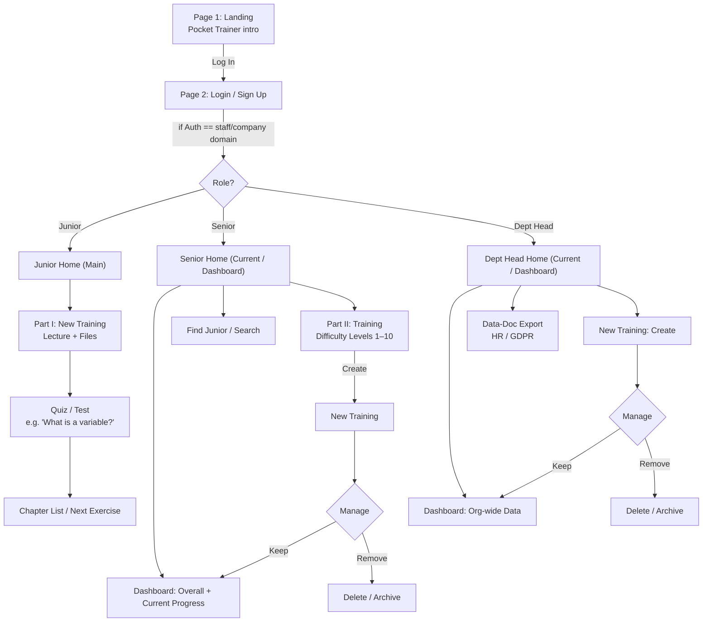
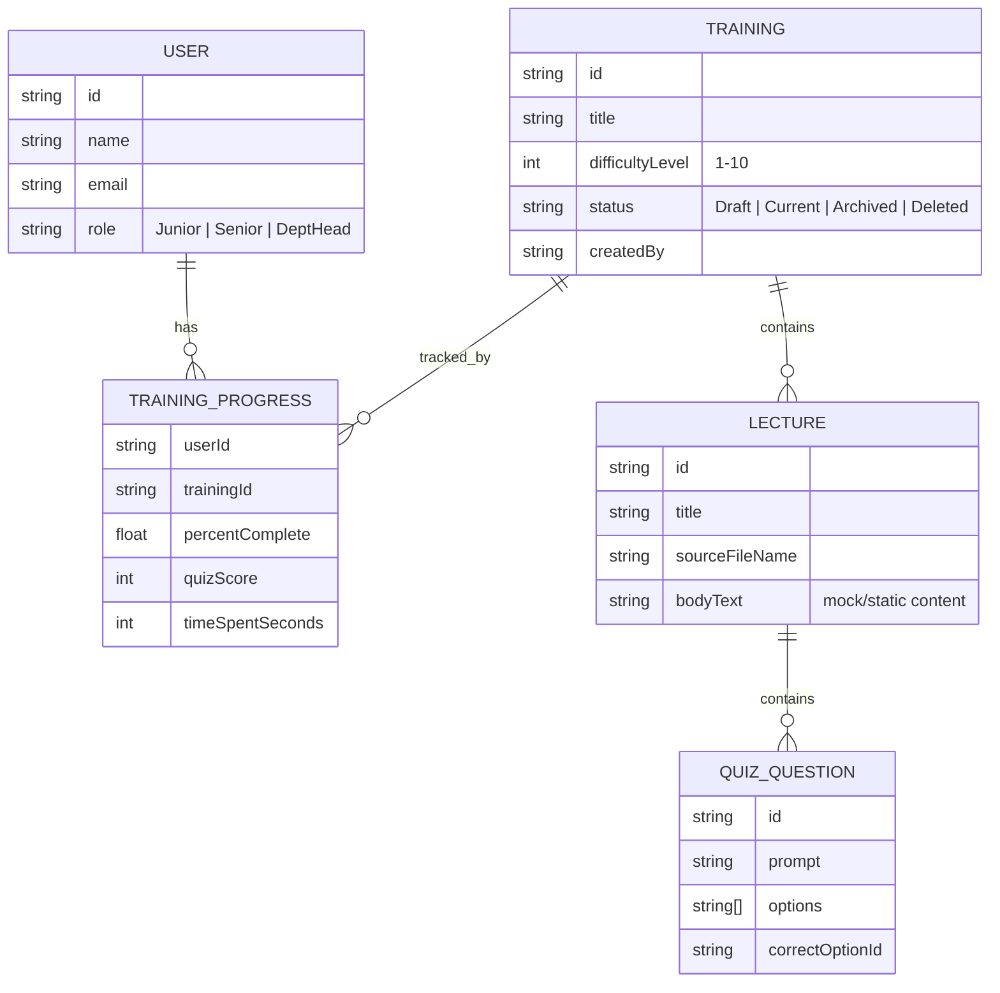
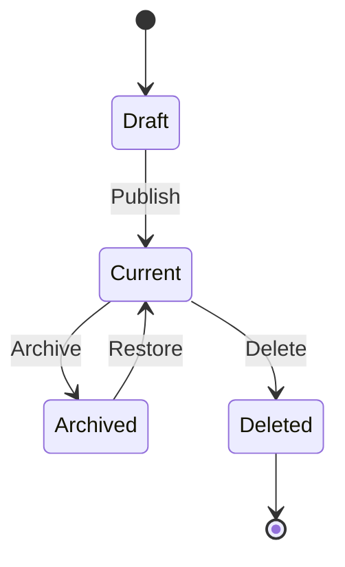
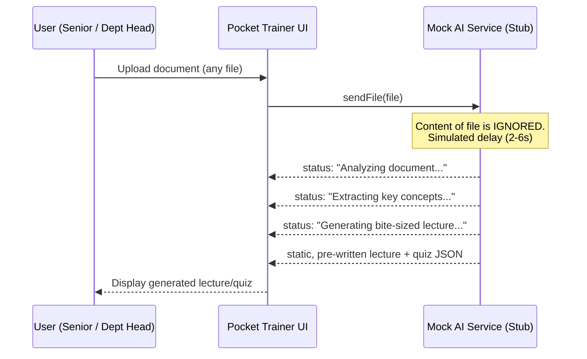

# 🚀 Pocket Trainer (PT) — Product Requirements Document

  

> **PT** turns any document a non-technical department head has lying around into a bite-sized, quiz-backed training module — no instructional-design skills required.

---

## 📋 Document Control

| Field | Value |
|---|---|
| Project Name | **PT — Pocket Trainer** |
| Team | Deniz Ikili (+ teammates) |
| Document Owner | Deniz Ikili |
| Prepared | 2026-09-26 |
| Status | Draft — Hackathon Build Spec |
| Source Material | Hand-drawn wireframes, requirements notes, persona & user-story sheet (see [Appendix](#22-appendix-original-wireframe-references)) |

---

## 📑 Table of Contents

1. [Document Control](#-document-control)
2. [Executive Summary](#3-executive-summary)
3. [Problem Statement](#4-problem-statement)
4. [Target Persona](#5-target-persona)
5. [Goals & Success Metrics](#6-goals--success-metrics)
6. [User Stories](#7-user-stories)
7. [Roles & Permissions](#8-roles--permissions)
8. [Scope](#9-scope)
9. [Information Architecture & User Flow](#10-information-architecture--user-flow)
10. [Page-by-Page Wireframe Specification](#11-page-by-page-wireframe-specification)
11. [Functional Requirements](#12-functional-requirements)
12. [Optional / Stretch Requirements](#13-optional--stretch-requirements)
13. [Differentiators](#14-differentiators--what-sets-us-apart)
14. [Non-Functional Requirements](#15-non-functional-requirements)
15. [Data Model](#16-data-model)
16. [Training Lifecycle](#17-training-lifecycle)
17. [Tech Stack & Architecture](#18-tech-stack--architecture)
18. [🎯 Directive to the Building Agent](#19-directive-to-the-building-agent)
19. [Suggested Build Order](#20-suggested-build-order)
20. [Risks & Assumptions](#21-risks--assumptions)
21. [Glossary](#22-glossary)
22. [Appendix: Original Wireframe References](#22-appendix-original-wireframe-references)

---

## 3. Executive Summary

**Pocket Trainer (PT)** is a role-based corporate training platform. A non-technical department head uploads a source document; PT converts it into a short lecture with a quiz, tailors difficulty to the intended audience, and lets managers track who has learned what. The hackathon build's job is to prove the **experience** end-to-end — every screen in the wireframes must be clickable and populated with data — while the "AI conversion" step is explicitly **simulated** (a scripted, delayed response, not a real model call).

---

## 4. Problem Statement

> *"I am a non-technical lead and I find it really difficult to make high quality lectures/training programs in fields which require other heads."*
> — Maria, Head of HR (persona quote, verbatim from project notes)

Department heads who are experts in their domain (but not in instructional design) struggle to turn what they know — or what's sitting in a document — into training material their juniors and seniors can actually learn from. Existing tools require either technical setup or manual authoring skill neither Maria nor most department heads have.

---

## 5. Target Persona

| Field | Detail |
|---|---|
| **Name** | Maria |
| **Position** | Head of HR |
| **Qualifications** | Highly skilled in training · Highly engaging · Great teacher & mentor · **Non-technical** |
| **Core Issue** | Can't produce high-quality lectures/training programs for fields owned by *other* department heads |
| **Key words she associates with the problem** | Cooperation · Trainings · Lectures · Engagement |

---

## 6. Goals & Success Metrics

| Goal | Metric (demo-appropriate) |
|---|---|
| Prove the full role-based journey works | 100% of wireframe screens reachable via clicks, no dead ends |
| Prove the "upload → lecture" magic moment | Upload-to-lecture flow completes in < 6s simulated time, every time |
| Prove management value | Senior & Dept Head dashboards show real (mock) progress data, not empty states |
| Prove compliance-awareness | Dept Head can view/export a mock GDPR/HR data document |

---

## 7. User Stories

| # | As a... | I want to... | So that... |
|---|---|---|---|
| US-1 | **Junior** | study & get deep insights on the training material | I can secure/earn a job position, or at least master a new field |
| US-2 | **Senior** | follow the training progress | I can document my capabilities and see where the juniors are lacking |
| US-3 | **Department Head** | know the data on training sessions (both junior & senior) | I can make long-term plans for the department and company |

---

## 8. Roles & Permissions

| Capability | Junior | Senior | Dept. Head |
|---|:---:|:---:|:---:|
| Log in / Sign up | ✅ | ✅ | ✅ |
| Consume lectures & take quizzes | ✅ | — | — |
| View own progress / chapter list | ✅ | — | — |
| View juniors' progress & search juniors | — | ✅ | ✅ |
| Create new training ("Part II") | — | ✅ | ✅ |
| Delete / Archive a training | — | ✅ | ✅ |
| Org-wide dashboard (Junior + Senior data) | — | — | ✅ |
| Export HR / GDPR data document | — | — | ✅ |

---

## 9. Scope

**In scope (hackathon demo):**
- Full clickable UI for all three roles
- Mocked authentication (company-email gate)
- Simulated ("Wizard-of-Oz") AI lecture/quiz generation from an uploaded file
- Mock dashboards, progress charts, and search for Senior & Dept Head
- Create / Delete / Archive training flow
- Mock GDPR/HR data-export view

**Out of scope (explicitly deferred):**
- A real, trained/integrated AI model
- Real company SSO / identity provider integration
- Production-grade database, hosting, or multi-tenant security hardening
- Real market/sub-market research tooling (OPT-3 is a positioning exercise, not a feature)

---

## 10. Information Architecture & User Flow

**Workflow rules captured from the wireframes:**
1. **Junior:** Log in/Sign up → Training → Lecture/Quiz Page.
2. **Senior:** Log in/Sign up → Current → New Training → *(Delete/Archive available)*.
3. **Dept Head:** Log in/Sign up → Current → New Training → *(Delete/Archive available)*.

---

## 11. Page-by-Page Wireframe Specification

| Sketch Ref | Page | Role(s) | Key Elements (from wireframe) | Primary Actions |
|---|---|---|---|---|
| 1 | **Landing** | All | "PT" logo, "Pocket Trainer" name, "Designed by: Deniz Ikili" credit | → Log In |
| 2 | **Login / Sign Up** | All | Login fields, Sign-up fields, staff-auth branch ("if Auth == staff"), "can't log in? contact ID", Back | Submit → role-based redirect |
| 3 | **Junior — Main** | Junior | Top nav ("Training" tab active), Current Training, Test Summary, Report/Sign-out | → Part I – New Training |
| 4 | **Part I – New Training** | Junior | Lecture list, attached files, refresh/upload icon, Back | Open a lecture |
| 5 | **Quiz / Test** | Junior | Question (e.g. "What is a variable?"), multiple-choice options with correct/incorrect marking, chapter list, "exercise to the end", Back | Answer → next question/chapter |
| 6 | **Senior — Current / Dashboard** | Senior | Overall + Current progress boxes, progress chart, "Find Jr" search, dashboard table | Search junior, drill into progress |
| 7 | **Part II – Training** | Senior | Difficulty toggle (Levels 1–10), topic boxes, "Find Jr" field | Create/select training by difficulty |
| 8 | **Dept Head — Current / Dashboard** | Dept Head | Org dashboard, "Data-Doc for HR/GDPR" export box, staff/training listing | View org data, export doc |
| 9 | **New Training (shared)** | Senior, Dept Head | Training creation form | Create → appears in Current; Delete/Archive available |

---

## 12. Functional Requirements

| ID | Requirement | Description | Priority | Related Page(s) |
|---|---|---|---|---|
| **FR-1** | Files upload ⇒ Lectures | Authorized user (Senior/Dept Head) uploads a source document; the system converts it into a bite-sized lecture + quiz. **In this build, this step is the simulated AI stub — see [Directive §19, Deliverable 2](#19-directive-to-the-building-agent).** | Must-have | Part I / Part II – New Training |
| **FR-2** | Company email ⇒ Auth | Login/signup is gated on a company-style email; the account's role (Junior/Senior/Dept Head) is assigned at signup or via an imported staff list. | Must-have | Login / Sign Up |
| **FR-3** | Audience ⇒ Difficulty tailoring | Lecture/quiz difficulty adapts to the target audience (see Level 1–10 selector in the Senior "Part II" sketch). | Must-have | Part II – Training |

---

## 13. Optional / Stretch Requirements

| ID | Requirement | Notes |
|---|---|---|
| **OPT-1** | Time complexity | Track how long users take per lecture/quiz for reporting purposes. |
| **OPT-2** | Model (AI) tailoring | A *real* AI personalization layer — explicitly **not** built this hackathon; the demo uses the static stub described in FR-1. |
| **OPT-3** | Market & sub-market research | Positioning exercise for the pitch, not an in-app feature. |
| **OPT-4** | GDPR & security compliance | Powers the Dept Head "Data-Doc for HR/GDPR" export box in the wireframes. |

---

## 14. Differentiators — "What Sets Us Apart"

1. 🧠 **In-house AI model** (simulated for demo — see Directive §19)
2. 🍬 **Bite-sized** lectures, quizzes, and tests
3. 💡 **Simple explanations → deep understanding**

---

## 15. Non-Functional Requirements

| Category | Requirement |
|---|---|
| **Responsiveness** | Mobile-first layout — "Pocket" implies on-the-go use |
| **Performance** | Any screen transition < 300ms; simulated AI delay capped at 6s |
| **Security (perceived)** | Auth gate must visibly check for a company-style email domain |
| **Accessibility** | Sufficient color contrast on correct/incorrect quiz states; keyboard-navigable forms |
| **Compliance (perceived)** | A visible, exportable "HR/GDPR Data-Doc" view for Dept Head |

---

## 16. Data Model

---

## 17. Training Lifecycle

---

## 18. Tech Stack & Architecture

| | **Option A — Preferred** | **Option B — Fallback** |
|---|---|---|
| **UI Framework** | React (component-based, matches wireframe screen structure 1:1) | Plain HTML5 |
| **Styling** | Tailwind CSS | Tailwind CSS (CDN build) |
| **Icons** | `lucide-react` | Inline SVG / emoji |
| **Charts (Senior/Dept dashboards)** | `recharts` or `chart.js` | `chart.js` via `<script>` tag |
| **CSV / staff-list import** | `papaparse` | Vanilla `FileReader` + manual CSV parse |
| **Client interactivity** | React state/hooks | Vanilla JavaScript |
| **Data persistence (demo)** | `localStorage` / `IndexedDB` | Lightweight **PHP** endpoints (PDO + SQLite, or flat JSON files) so data entered in the browser survives a page reload |
| **When to use** | Default choice for this build | Only if React isn't available/suitable in the agent's environment |

> Use **Option A** unless there is a concrete reason not to. If falling back to **Option B**, PHP's job is strictly persistence (save/load JSON) — no server-side business logic beyond that.

---

## 19. 🎯 Directive to the Building Agent

> **You are the agent implementing this project. The following four deliverables are mandatory. Do not skip or partially satisfy any of them.**

### ✅ Deliverable 1 — Dynamic, Fully-Clickable Demo
- [ ] **MUST** implement *every* page listed in [§11 Page-by-Page Specification](#11-page-by-page-wireframe-specification) as a real, navigable screen — no static mockup images standing in for a page.
- [ ] **MUST** implement the exact routing described in [§10](#10-information-architecture--user-flow), including the three-way role split after login.
- [ ] **MUST** seed the app with sample mock data on load (e.g. 3 Juniors, 2 Seniors, 4 trainings) so dashboards are never empty.
- [ ] **MUST** make Create / Delete / Archive training actually mutate app state and reflect immediately in the UI.

### ✅ Deliverable 2 — Simulated "In-House AI" Layer (Static Stub)
- [ ] **MUST** implement FR-1 (Files Upload ⇒ Lectures) as a **Wizard-of-Oz stub**, following this sequence:

- [ ] The returned lecture/quiz content **MUST NOT** depend on what was actually uploaded — pick from a small fixed array of canned payloads (random or round-robin is fine).
- [ ] **MUST** clearly code-comment this function as a placeholder (e.g. `// STUB: simulates AI generation, does not read file contents`).
- [ ] Front-end copy shown to the demo audience *may* say things like "AI is generating your lecture…" for narrative purposes — but Deliverable 3's documentation **MUST** disclose plainly that this is mocked, not a real model call.

### ✅ Deliverable 3 — Detailed Documentation
- [ ] **MUST** produce a README covering:
  - Tech stack used and why
  - Folder/file structure
  - How to install and run the project locally
  - The full data model (mirror [§16](#16-data-model))
  - A **"Known Limitations / Mocked Components"** section explicitly naming: the AI stub, the auth mock, and how persistence works
  - A short **"Path to Production"** note: what would need to change to plug in a real AI model and real auth

### ✅ Deliverable 4 — Tech Stack Compliance
- [ ] **MUST** default to **Option A** from [§18](#18-tech-stack--architecture): React + Tailwind + the listed libraries.
- [ ] **MUST** fall back to **Option B** (HTML + Tailwind + vanilla JS + basic PHP for browser-entered data persistence) only if React is not viable in the build environment — and must state in the README which option was used and why.

---

## 20. Suggested Build Order

| Phase | Focus |
|---|---|
| 1 | Landing + Login/Signup + role routing |
| 2 | Junior flow: Main → Part I → Quiz → Chapter list |
| 3 | Senior flow: Dashboard → Find Junior → Part II (difficulty levels) |
| 4 | Dept Head flow: Dashboard → Data-Doc/GDPR export |
| 5 | New Training create/Delete/Archive (shared by Senior + Dept Head) |
| 6 | Mock AI upload stub (Deliverable 2) |
| 7 | README + documentation pass (Deliverable 3) |

---

## 21. Risks & Assumptions

| Risk / Assumption | Mitigation |
|---|---|
| Judges may assume the AI is real | Documentation must clearly disclose the stub (Deliverable 3) |
| Hackathon time constraints | Suggested Build Order (§20) prioritizes visible, clickable flow first |
| "Company email" auth has no real identity provider behind it | Acceptable for demo — treat as a UI-level gate only, per Scope §9 |
| Hand-drawn wireframes leave some UI details ambiguous | Where ambiguous, default to the simplest interpretation that satisfies the FR/user story it serves |

---

## 22. Glossary

| Term | Meaning |
|---|---|
| **PT** | Pocket Trainer |
| **Junior** | End-learner role; consumes lectures/quizzes |
| **Senior** | Teacher/mentor role; tracks juniors, creates Part II trainings |
| **Dept Head** | Admin role; org-wide data, creates trainings, GDPR/HR export |
| **Current** | The active/published set of trainings a role sees on their home dashboard |
| **Archive** | A soft-removed training, recoverable |
| **Delete** | A hard-removed training |
| **Difficulty Tailoring** | Adjusting lecture/quiz complexity to a target audience (Levels 1–10) |

---

## 22. Appendix: Original Wireframe References

- **Sketch A** — Full flow diagram: Landing → Login/Signup → Junior / Senior / Dept Head branches, with page-level layout sketches for each screen.
- **Sketch B** — Functional & optional requirements list, plus "What sets us apart."
- **Sketch C** — Project name, team, persona (Maria), issue statement, and the three user stories.

*(Original hand-drawn sketches held separately by the team; this PRD is the structured transcription of that material.)*
